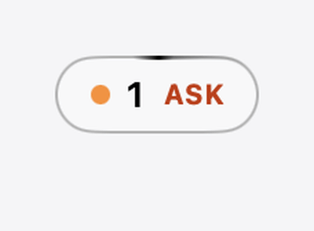
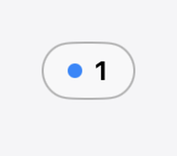
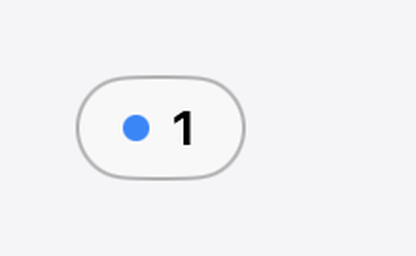
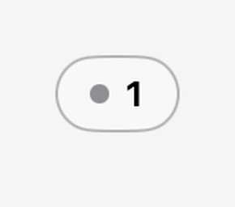
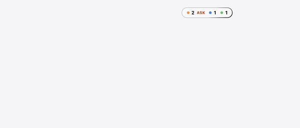
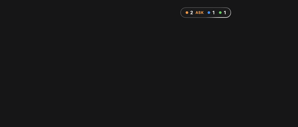
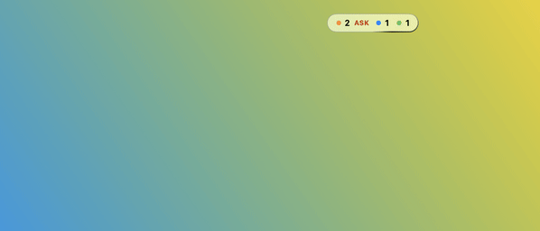

<p align="center">
  
</p>

<h1 align="center">Agent Float</h1>

<p align="center">
  Never miss an agent waiting for you.
</p>

<p align="center">
  <strong><a href="https://enjoywater.github.io/agent-float/en/">Explore the Feature Guide ↗</a></strong>
  <br>
  <sub>See the screens and try interactive demos without installing the app.</sub>
</p>

<p align="center">
  README: <a href="README.md" lang="ko">한국어</a> · <strong>English</strong>
  <br>
  Feature Guide: <a href="https://enjoywater.github.io/agent-float/" lang="ko">한국어</a> · <a href="https://enjoywater.github.io/agent-float/en/" lang="en">English</a>
</p>

<p align="center">
  <a href="#installation">Install</a> ·
  <a href="#supported-agents-and-discovery">Support</a> ·
  <a href="#status-at-a-glance">Status</a> ·
  <a href="#reply-from-the-floating-panel">Reply</a> ·
  <a href="#known-limitations">Limitations</a> ·
  <a href="#development">Development</a>
</p>

<p align="center">
  
  
  
  
</p>

<p align="center">
  <picture>
    <source media="(prefers-color-scheme: dark)" srcset="docs/media/en/hero-dark.gif?v=20261030-3">
    
  </picture>
  <br>
  <sub>Recordings use fictional sessions and simulated delivery results.</sub>
</p>

## Introduction

Explore the screens and interactions in the [feature guide ↗](https://enjoywater.github.io/agent-float/en/). It opens in your browser and includes interactive demos without installing the app.

When AI agents run in several terminals, checking who needs an answer means opening tabs one by one. Agent Float gathers discovered sessions into a small glass pill in the corner of your Mac's screen.

- **See**: waiting, running, and done counts appear in the pill, with an animated border when a session needs you.
- **Go**: hover to expand the session list, then click a row to reach its terminal tab.
- **Reply**: answer supported questions directly in the panel.

Agent Float reads Claude Code and Codex sessions, navigates to terminals it can locate, and lets you answer questions. Both agents share the list and reply interface, but their discovery scopes differ.

The second line of each session and the reply header show a `Claude` / `Codex` name badge. The badge identifies the agent; the adjacent terminal icon identifies where it runs. Title space and status-dot meanings stay the same. Switch Panel, Expand in Row, and Side Card all use the same name badges.

## Supported Agents and Discovery

| Capability | Claude Code | Codex |
|---|---|---|
| Discovery | Session files in `~/.claude/sessions` plus process liveness | Local shared app-server state matched to live TUI processes and actual terminals |
| Automated sessions | Live session files can appear without an attached terminal | Excludes automation or transient server sessions without a real TUI and terminal |
| Navigation | Uses the discovered terminal location; see the table below | Requires a unique terminal match by title and working directory |
| Replies | Single/multiple selection, custom input, multiple questions, text questions | Single selection, custom notes, multiple questions, text questions |
| Approvals | Read-only; approve in the terminal | Read-only; approve in the terminal |

Codex does not treat old threads left on the shared server as open sessions. It checks a live TUI with the same Codex home and working directory, its current terminal title, and a unique locator. Closed or ambiguous sessions are excluded. Changes appear on the existing five-second polling cycle.

Validated with Codex 0.165.0. `--no-daemon`, separate or remote servers, and IDE/desktop sessions that do not use the shared server are outside the supported scope. Renamed or duplicate terminal titles can prevent discovery. See [Codex discovery, navigation, and replies](docs/codex-detection.md) (Korean) for details and validation.

### Why Sessions You Did Not Launch May Appear

Claude Code can discover sessions launched by bots or schedulers. A live process with a session file may appear even if you never opened a terminal for it. Records belonging to exited processes are excluded.

Claude titles prefer the AI conversation title, then the session-file name, then the localized `Untitled session` label. Automated jobs without an AI title may retain temporary names such as `1700000000000-…-draft`. Numeric names alone do not prove automation.

There is currently **no automatic manual/automated/unknown classification or filter**. Terminal attachment, ancestry, options, and working directory can help distinguish them, but a missing terminal is not conclusive: manually launched background sessions also exist.

## Status at a Glance

Question detection chooses Korean or English rules for each sentence independently of the interface language. Recognized optional offers and closing remarks count as done. Decisions, action requests, and waiting declarations count as waiting. Code and URL question marks are ignored; ambiguous conditions may still count as waiting.


The collapsed pill shows counts in **waiting → running → done** order.

<table>
  <tr>
    <td align="center" width="50%">
      <picture>
        <source media="(prefers-color-scheme: dark)" srcset="docs/media/en/state-ask-dark.gif">
        
      </picture>
      <br><b>Orange · Awaiting You</b>
      <br><sub>Waiting for approval, a question dialog, or an answer to a question in the last reply</sub>
    </td>
    <td align="center" width="50%">
      <picture>
        <source media="(prefers-color-scheme: dark)" srcset="docs/media/en/state-running-dark.gif">
        
      </picture>
      <br><b>Blue · Running</b>
      <br><sub>Working, or expected to resume through <code>/loop</code>, a scheduled wakeup, or a background job</sub>
    </td>
  </tr>
  <tr>
    <td align="center">
      <picture>
        <source media="(prefers-color-scheme: dark)" srcset="docs/media/en/state-new-dark.gif">
        
      </picture>
      <br><b>Green · Done</b>
      <br><sub>The turn ended and accepts further input; this does not guarantee the task succeeded</sub>
    </td>
    <td align="center">
      <picture>
        <source media="(prefers-color-scheme: dark)" srcset="docs/media/en/state-unknown-dark.gif">
        
      </picture>
      <br><b>Gray · Unknown</b>
      <br><sub>An unknown status value or a session that has not responded for a while</sub>
    </td>
  </tr>
</table>

The pill's border animates when something needs attention.

- `ASK`: a session is waiting for you. It stays until the actual wait resolves.
- `NEW`: an unseen completion. It clears when you click that row, directly select its tab in Ghostty/Terminal.app/iTerm2, or the session resumes work. Expanding the list alone does not clear it.

## Click a Row to Reach Its Terminal

Locatable rows have a hover highlight and navigation action. Codex uses the same navigation paths. Background attachment with `claude --bg` and the generic app fallback below apply to Claude Code.

| Terminal | Clicking a row |
|---|---|
| Ghostty | Select the tab by title and working directory |
| Orca | Select its terminal tab through the `orca` CLI |
| Herdr desktop app | Verify the local terminal, select it through `herdr-app`, and raise Herdr |
| Terminal.app · iTerm2 | Select the tab/session by tty |
| tmux, in any terminal | Select its pane, then raise the outer terminal; select its tab too in Terminal.app/iTerm2. With no attached client, attach in a new Ghostty tab |
| `claude --bg` background session | Run `claude attach <jobId>` in a new Ghostty tab |
| Other terminals, such as Cursor or Warp | Raise the owning app |
| No locator | Navigation hover and click are disabled |

Failed navigation beeps when the target tab or app cannot be found. The destination app must actually reach the foreground within one second before `NEW` clears.

## Reply from the Floating Panel

Click a row waiting on a question dialog (choices, custom input, multiple selection, or multiple questions) or a question in the last reply to open the reply view. Approval rows show details only. Command-click navigates directly to the terminal.

Codex supports `request_user_input` choices, notes under `None of the above`, sequential multi-question answers, and text questions in the final reply. Multiple selection within one question is supported for Claude Code. The terminal transport restrictions below apply to both agents.

<p align="center">
  <picture>
    <source media="(prefers-color-scheme: dark)" srcset="docs/media/en/reply-choice-dark.gif?v=20261030-3">
    
  </picture>
</p>

<table>
  <tr>
    <td align="center" width="33%"><br><b>Multiple Questions</b><br><sub>Answer in order, then review and send together</sub></td>
    <td align="center" width="33%"><br><b>Questions in the Last Reply</b><br><sub>Read the last message and write your answer</sub></td>
    <td align="center" width="33%"><br><b>Approval Requests</b><br><sub>Details only; approve in the terminal</sub></td>
  </tr>
</table>

| Terminal | Question Dialogs | Questions in the Last Reply |
|---|---|---|
| tmux, in any terminal, including Orca team tmux | Send | Send |
| Orca | Send | Send |
| Ghostty | Send only to the selected, unsplit tab in a visible window; otherwise read-only | Send under the same restrictions |
| Herdr · Terminal.app · iTerm2 · others | Read-only | Read-only |

### No Verification, No Send

<table>
  <tr>
    <td align="center" width="50%"><br><b>Stop When There Is an Existing Draft</b></td>
    <td align="center" width="50%"><br><b>Keep <code>FAIL</code> When the Record Differs</b></td>
  </tr>
</table>

- Delivery sends one input at a time and verifies each screen change, then compares the recorded answer with the intended answer. If verification fails, it stops and explains why, such as an existing terminal draft or a changed question.
- Text composers can contain faint suggestions even when empty. tmux exposes faint styling; Orca exposes actual text through `draft`, so both can check before input. Ghostty exposes neither, so delivery inserts one probe character. It continues only if the field contains that character alone. If an existing draft was found, it erases the probe and stops.
- Replies are limited to 800 UTF-16 units for both agents, based on Claude Code's long-paste folding into `[Pasted text]`.
- Replies beginning with `/`, `!`, or `#`, containing `@`, or spanning multiple lines must be sent in the terminal: completion or newline handling can intercept Enter.
- Interrupted delivery or a mismatched recording leaves red `FAIL` at the front of the pill and a `Needs attention` group at the top of the list. Clear it explicitly with `Close` or `Open in Terminal` in its failure view, or by Command-clicking the row.

### Keyboard Input

- The panel accepts keys only while replying. It does not activate the app; closing returns input to your previous app so you can continue typing.
- Use 1–9 for options, Return to send (only commit composition while an IME is composing), Tab to enter/leave text fields, and Escape to leave a field then return to the list. Fields support Command-C/V/A/Z. Drafts survive reopening the same question.

### Reply Placement

Choose `Reply View` in the menu.

<table>
  <tr>
    <td align="center" width="50%"><br><b>Switch Panel</b> (default)<br><sub>The panel becomes the selected session's reply view</sub></td>
    <td align="center" width="50%"><br><b>Expand in Row</b><br><sub>The selected row expands in place</sub></td>
  </tr>
  <tr>
    <td align="center" colspan="2"><br><b>Side Card</b><br><sub>Keep the list and open an adjacent reply card</sub></td>
  </tr>
</table>

## On Any Background

The glass pill adapts its tone to the background.

<table>
  <tr>
    <td align="center"><br><sub>Light solid color</sub></td>
    <td align="center"><br><sub>Light screen with text</sub></td>
    <td align="center"><br><sub>Wallpaper</sub></td>
  </tr>
  <tr>
    <td align="center"><br><sub>Dark solid color</sub></td>
    <td align="center"><br><sub>Code editor</sub></td>
    <td align="center"><br><sub>Vivid gradient</sub></td>
  </tr>
</table>

<p align="center"><sub>Top row: light mode. Bottom row: dark mode. All use the default <code>Outline</code>.</sub></p>

When similar tones make the edge hard to distinguish, choose `Edge Contrast` in the menu.

- `Outline` (default): a thin contrasting edge.
- `Inverse of Background`: paint a contrasting pill. Strong on solid colors, less reliable over dense light text.
- `Plain Glass`: preserve the tone chosen by glass.

## Installation

Requirements

- macOS 26+ (Liquid Glass)
- Swift 6 (Xcode 26 or Command Line Tools)
- `/usr/local/bin/orca` for Orca navigation
- A local shared-server Codex CLI for Codex discovery (0.165.0 validated)

```sh
git clone https://github.com/Enjoywater/agent-float.git
cd agent-float
scripts/create-signing-identity.sh   # Once; see Signing below.
make install                         # Install to /Applications and launch after quitting the existing app.
```

Use `make install INSTALL_DIR=~/Applications` for another destination.

### First-Run Permissions

- The first navigation to Ghostty, Terminal.app, or iTerm2 requests Automation permission for that app. Restore denied permission in System Settings > Privacy & Security > Automation.
- Replying in Ghostty requires Accessibility permission to read and verify its screen. Opening the first Ghostty reply requests it; `Open Settings` provides recovery after denial.

### Signing

The local-only self-signed `Agent Float Local Signing` certificate in your login keychain preserves Accessibility/Automation grants between builds. Create it once with `scripts/create-signing-identity.sh`; it contains only the app name. Without it, builds warn and use ad-hoc signing, which may require renewed permission after every rebuild.

## Menu

By default the app appears only in the menu bar through the  icon, without a Dock icon. Settings include `Reset Position`, `Edge Contrast`, `Reply View`, `Icon Location`, `Language`, `Launch at Login`, and `Quit Agent Float`.

- `Language`: the menu always uses that English title and lists `한국어`, then `English`. Changes apply immediately and persist. Until you choose, the first macOS preferred language selects Korean if it starts with `ko`; all other languages use English. There is no Follow System option.
- `Reset Position`: drag the summary row to move the pill. Position persists and is clamped after display changes. Reset restores its default corner. Long lists scroll, and Reduce Motion follows macOS settings.
- `Icon Location`: Menu Bar (default), Dock, or Both. Dock presence includes Command-Tab; hiding the menu bar icon preserves settings in the Dock context menu.
- `Reply View`: see [Reply Placement](#reply-placement).
- `Edge Contrast`: see [On Any Background](#on-any-background).
- `Launch at Login`: remembers the registered app location. System Settings may require approval; Option-select can unregister a blocked item. Register the installed app so `make clean` does not remove it.

Herdr support targets the desktop app using `herdr-core` and `herdr-app`, rather than the older `herdr` CLI. Its terminal IDs, process ownership, and window placement must agree. Missing or ambiguous targets fail without falling back to Ghostty. Direct replies in Herdr remain read-only.

## Known Limitations

<details>
<summary>Expand</summary>

- System-rendered text, such as text-field context menus, follows macOS language rather than the app's Language setting.
- Question detection is heuristic. Ambiguous conditional explanations can produce waiting false positives; neither language support nor completion status guarantees correctness.

- The pill can slide during Space-switch animations, returning to its position afterward.
- Window managers such as Magnet may snap it.
- Manual Orca tab/tmux pane changes do not clear `NEW`.
- tmux inside Ghostty selects the pane but cannot identify its Ghostty tab because Ghostty does not expose tab ttys.
- Failed Terminal.app/iTerm2 tab selection for an outer tmux terminal, for example after denied Automation permission, can change the tmux pane but still beep.
- Claude session files are measured behavior, not a public schema. Unknown values remain gray.
- Codex matches local shared app-server state to a live TUI's unique terminal title (0.165.0 validated). Separate, remote, or `--no-daemon` servers are excluded; ambiguous/renamed titles may disappear.
- Reply screen recognition depends on measured Claude Code 2.1.309 and Codex 0.165.0 layouts. Changed screens stop delivery before input or leave a failure if input started.
- No automated/manual Claude session filter exists. See [Why Sessions You Did Not Launch May Appear](#why-sessions-you-did-not-launch-may-appear) for numeric or temporary job names.
- Ghostty text probing can briefly insert/erase one character in an existing draft. Hidden, other-Space, or split tabs remain read-only.
- Approval is always handled in the terminal; the panel shows details only.
- Orca suggestions may look like actual draft text and block delivery. Reply in the terminal when the suggestion cannot be distinguished from a draft.

</details>

## Development

```sh
make test     # Unit tests (swift test).
make bundle   # Assemble and sign build/Agent Float.app; see Signing above.
make run      # Assemble and launch.
make install  # Install to /Applications and launch after quitting the existing app.
make clean
```

`AgentProvider` is the common protocol. [ClaudeCodeProvider](Sources/AgentFloatCore/Claude/ClaudeCodeProvider.swift) and [CodexCodeProvider](Sources/AgentFloatCore/Codex/CodexCodeProvider.swift) implement it; `SessionStore` collects their results. `ReplyDelivery` is shared, while screen interpretation and transcript verification follow each agent's format.

### Validation

The default `make test` does not type into real user sessions. Regression tests cover Codex discovery, exited-process exclusion, terminal matching, states/questions, reply verification, and transport failure/recovery.

With an active Codex session on the existing shared server, the following checks can be run separately. The first is read-only; the second actually focuses a Ghostty tab.

```sh
AGENT_FLOAT_TEST_LIVE_CODEX=1 swift test --filter liveSharedDaemonReadOnlySmoke
AGENT_FLOAT_TEST_LIVE_NAVIGATION=1 swift test --filter liveDetectedGhosttySessionCanBeFocused
```

Earlier validation displayed only one live TUI among three server threads and verified Ghostty navigation. Reply integration was tested with an isolated Codex home, local fake model responses, and a real TUI inside isolated tmux, verifying choices, notes, text, and two questions in sequence. These delivery checks made no model API calls. See the fixture manifest and optional checks in [Codex validation and scope](docs/codex-detection.md#검증과-범위) (Korean).

<details>
<summary>Development Environment Variables</summary>

Pass overrides with `open --env NAME=value "build/Agent Float.app"`.

| Variable | Effect |
|---|---|
| `AGENT_FLOAT_LANGUAGE=ko\|en` | Overrides saved/system language; useful for isolated media captures |
| `AGENT_FLOAT_DEBUG=1` | State/navigation/window logs on stderr; combine with `open --stderr <file>` |
| `AGENT_FLOAT_FAKE_SESSIONS=<count>` | Fictional sessions instead of real providers |
| `AGENT_FLOAT_MEDIA_SCENE=mixed\|choice\|multi\|body\|permission\|ask\|running\|new\|unknown` | Fixed fake media scenario |
| `AGENT_FLOAT_MEDIA_AGENT=claude\|codex` | Agent for the media question |
| `AGENT_FLOAT_CLAUDE_HOME=<folder>` | Alternative to `~/.claude` |
| `AGENT_FLOAT_CODEX_HOME=<folder>` | Codex socket home; otherwise `CODEX_HOME`, then `~/.codex` |
| `AGENT_FLOAT_APPEARANCE=light\|dark` | Appearance override |
| `AGENT_FLOAT_CONTRAST=standard\|outline\|inverse` | Contrast override: Plain Glass, Outline, or Inverse of Background |
| `AGENT_FLOAT_REDUCE_MOTION=1` | Exercise Reduce Motion |
| `AGENT_FLOAT_SLOW_MOTION=<factor>` | Slow animations |
| `AGENT_FLOAT_REPLY_PLACEMENT=panel\|inline\|card` | Placement override |
| `AGENT_FLOAT_FAKE_REPLY=delivered\|hidden\|accessibility\|draft\|stopped\|mismatch` | Simulated delivery results, only in fake mode (`AGENT_FLOAT_FAKE_SESSIONS`); no actual sending |

</details>

<details>
<summary>Project Layout</summary>

```
Sources/
  AgentFloatCore/        UI-independent logic (unit tested)
    Claude/              Session files, transcripts, and status derivation
    Codex/               Shared server, live TUI discovery, questions/replies
    Provider/            Provider protocol and SessionStore
    Model/ Signals/      Sessions, grouping, and ASK/NEW signal rules
    Navigation/          Ghostty, Orca, Terminal.app, iTerm2, tmux, and fallback
    System/ Window/      Process environment, ancestry, tty, and pill geometry
  AgentFloat/            App (NSPanel, SwiftUI views, menu bar)
Tests/
  AgentFloatCoreTests/   Core unit tests and screen fixtures
  AgentFloatTests/       Reply view state (ReplyCenter) tests
docs/
  specs/                 Design documents and UI concepts
  plans/                 Implementation plans and rulings
  checklists/            Manual checks and results
  media/                 README recordings
```

</details>

See the [design document](docs/specs/2026-10-16-agent-float-design.md) and [rulings](docs/plans/2026-10-16-agent-float-rulings.md) for the reasoning behind the design (Korean).

App copy lives in typed per-language `Strings` values. Core returns semantic data. Keep both README editions synchronized, using the Korean edition as the layout reference. Dated design documents, plans, and checklists remain in Korean as historical records. Compare question-rule changes on identical samples with `scripts/question-eval`; keep raw transcripts outside the repository and report only counts and fictional examples.
