English | [한국어](README.ko.md)

<p align="center"></p>
<h1 align="center">Agent Float</h1>
<p align="center">Never miss an agent waiting for you.<br><br>
<a href="#installation">Install</a> · <a href="https://enjoywater.github.io/agent-float/en/">Feature Guide ↗</a> · <a href="#supported-agents-and-discovery">Support</a> · <a href="#status-at-a-glance">Status</a> · <a href="#reply-from-the-floating-panel">Reply</a> · <a href="#known-limitations">Limitations</a> · <a href="#development">Development</a></p>
<p align="center">


</p>
<p align="center"><picture><source media="(prefers-color-scheme: dark)" srcset="docs/media/en/hero-dark.gif">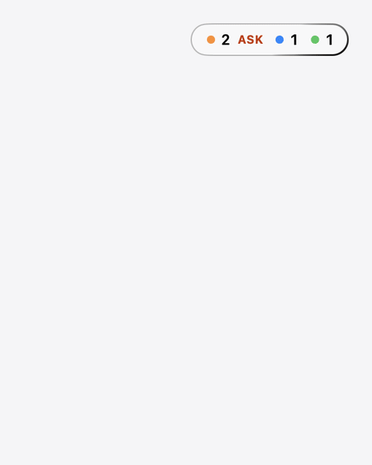</picture><br><sub>Recordings use fictional sessions, synthetic backgrounds, and simulated delivery.</sub></p>

## Introduction

Try the interactive [feature guide ↗](https://enjoywater.github.io/agent-float/en/) without installing anything.

When AI agents run in several terminals, checking who needs an answer means opening tabs one by one. Agent Float gathers discovered sessions into a small glass pill in the corner of your Mac's screen.

- **See:** waiting, running, and done counts, with an animated border when something needs attention.
- **Go:** hover to expand the list and click a row to reach its terminal.
- **Reply:** answer supported questions directly in the floating panel.

Claude Code and Codex share the list and reply interface, with different discovery scopes. Their `Claude` and `Codex` badges identify the agent; the adjacent terminal icon identifies where it runs. Badges appear in the list and all three reply placements without changing the status dots or consuming title space.

## Supported Agents and Discovery

| | Claude Code | Codex |
|---|---|---|
| Discovery | Session files in `~/.claude/sessions` plus process liveness | Local shared app-server state matched to live TUI processes and actual terminals |
| Automation | Live session files can appear without an attached terminal | Excludes automation or transient server sessions without a real TUI and terminal |
| Navigation | Uses the discovered locator; see the terminal table below | Requires a unique terminal match by title and working directory |
| Replies | Single/multiple selection, custom input, multiple questions, text questions | Single selection, custom notes, multiple questions, text questions |
| Approvals | Read-only; approve in the terminal | Read-only; approve in the terminal |

Codex discovery checks a live TUI with the same Codex home and working directory, its current terminal title, and a unique locator. Old threads left on the server do not count as open sessions. Closed or ambiguous sessions are excluded. Changes appear on the existing five-second polling cycle.

Validated with Codex 0.165.0. `--no-daemon`, separate or remote servers, and IDE/desktop sessions that do not use the shared server are outside the supported scope. Renamed or duplicate terminal titles can prevent discovery. See [Codex discovery, navigation, and replies](docs/codex-detection.md) (Korean).

### Why Sessions You Did Not Launch May Appear

Claude Code can discover sessions launched by bots or schedulers. A live process with a session file may appear even if you never opened a terminal for it. Records belonging to exited processes are excluded.

Claude titles prefer the AI conversation title, then the session-file name, then the localized `Untitled session` label. Automated jobs without an AI title may retain temporary names such as `1700000000000-…-draft`. Numeric names alone do not prove automation.

There is currently **no automatic manual/automated/unknown classification or filter**. Terminal attachment, ancestry, options, and working directory can help distinguish them, but a missing terminal is not conclusive: manually launched background sessions also exist.

## Status at a Glance

The collapsed pill shows **waiting → running → done** counts.

| Signal | Meaning |
|---|---|
| Orange / ASK | Waiting for a question or approval, including a question in the last reply |
| Blue | Working, or expected to resume through a Claude loop, scheduled wakeup, or background job |
| Green / Done | The turn ended and accepts further input; this does not guarantee the task succeeded |
| Gray | Unknown status or suspected inactivity |

<p align="center">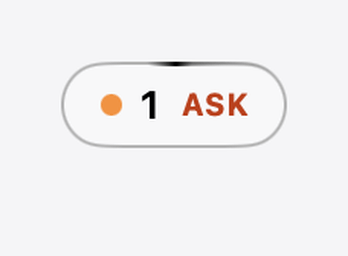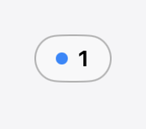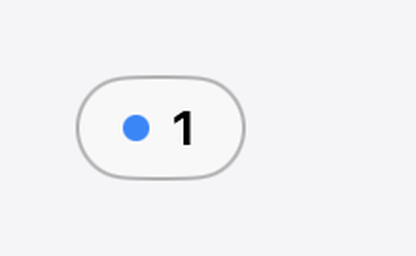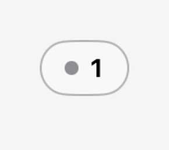</p>

The border animates when attention is needed:

- `ASK` stays until the actual wait resolves.
- `NEW` marks an unseen completion. It clears when you click that row, directly select its tab in Ghostty/Terminal.app/iTerm2, or the session resumes work. Expanding the list alone does not clear it.

Question detection supports Korean and English independently of the interface language, choosing rules for each sentence. Recognized optional offers and closing remarks count as done. Decisions, action requests, and waiting declarations count as waiting. Code and URL question marks are ignored; ambiguous conditions may still produce false positives.

## Click a Row to Reach Its Terminal

Locatable rows have a hover highlight and navigation action. Codex uses the same navigation paths; background attachment and generic app fallback below apply to Claude Code.

| Terminal | Navigation |
|---|---|
| Ghostty | Select the tab by title and working directory |
| Orca | Select its terminal through the `orca` CLI |
| Herdr desktop app | Select the verified local terminal through `herdr-app` and raise Herdr |
| Terminal.app / iTerm2 | Select the tab/session by tty |
| tmux, in any terminal | Select its pane, then raise the outer terminal; select its tab too in Terminal.app/iTerm2. With no attached client, attach in a new Ghostty tab |
| `claude --bg` | Run `claude attach <jobId>` in a new Ghostty tab |
| Other terminals, such as Cursor or Warp | Raise the owning app |
| No locator | Navigation hover and click are disabled |

Failed navigation beeps. The destination app must actually reach the foreground within one second before `NEW` clears.

## Reply from the Floating Panel

Click a waiting question row to open a reply. Approval rows show details only. Command-click navigates directly to the terminal.

Codex supports `request_user_input` choices, notes under `None of the above`, sequential multi-question answers, and text questions in the final reply. Multiple selection within one question is supported for Claude Code. Terminal transport restrictions apply to both agents.

<p align="center"><picture><source media="(prefers-color-scheme: dark)" srcset="docs/media/en/reply-choice-dark.gif">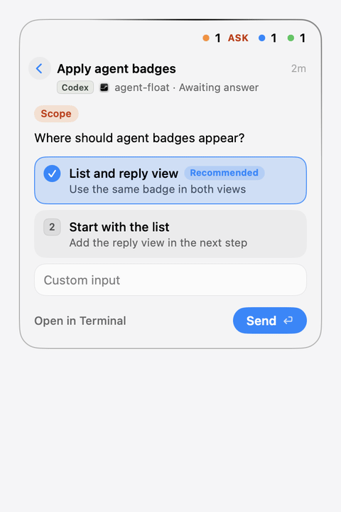</picture></p>

| Terminal | Dialogs | Text Questions |
|---|---|---|
| tmux, including Orca team tmux | Send | Send |
| Orca | Send | Send |
| Ghostty | Send only to the selected, unsplit tab in a visible window | Same restrictions |
| Herdr / Terminal.app / iTerm2 / others | Read-only | Read-only |

<p align="center">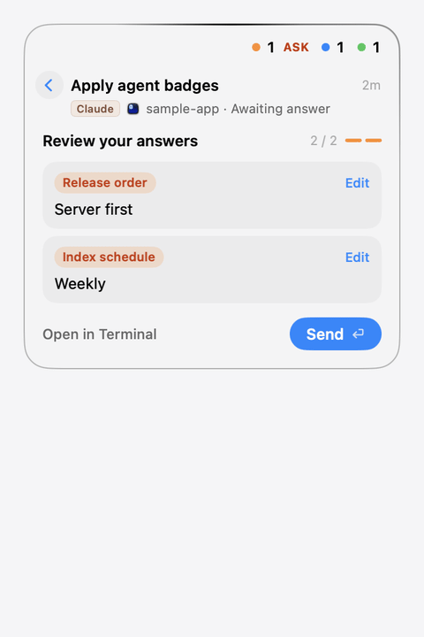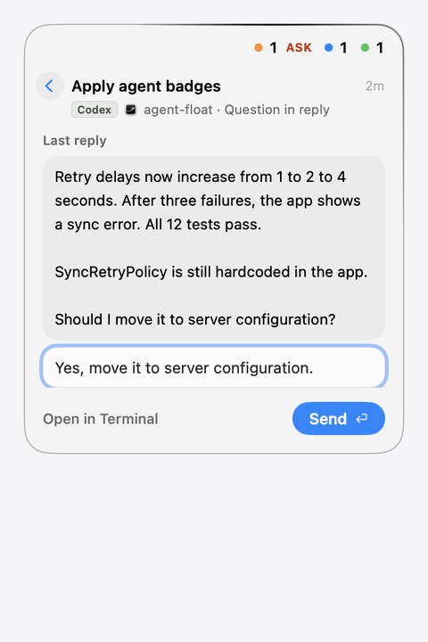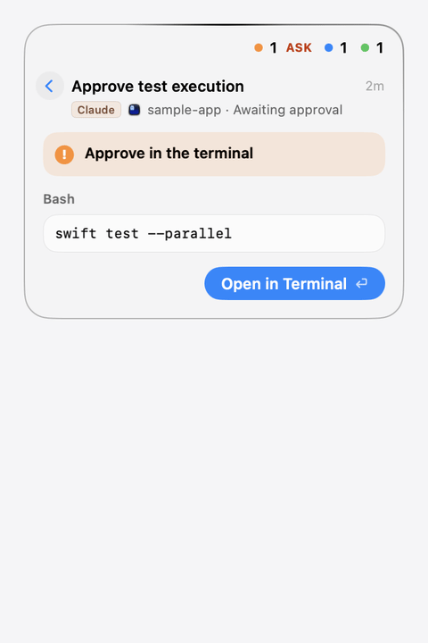</p>

### No Verification, No Send

- Delivery checks the same question, reads the screen, sends one input at a time and verifies each screen change, then compares the recorded answer with the intended answer. If verification fails, it stops and explains why.
- Text composers can contain faint suggestions even when empty. tmux exposes faint styling; Orca exposes actual text through `draft`. Ghostty exposes neither, so delivery inserts one probe character. It continues only if the field contains that character alone. If an existing draft was found, it erases the probe and stops.
- Replies are limited to 800 UTF-16 units for both agents, based on Claude Code's long-paste folding behavior.
- Replies beginning with `/`, `!`, or `#`, containing `@`, or spanning multiple lines must be sent in the terminal: completion or newline handling can intercept Enter.
- Interrupted delivery or a mismatched recording leaves red `FAIL` at the front of the pill and a `Needs attention` group. Clear it explicitly by closing its failure view, opening its terminal, or Command-clicking the row.

<p align="center">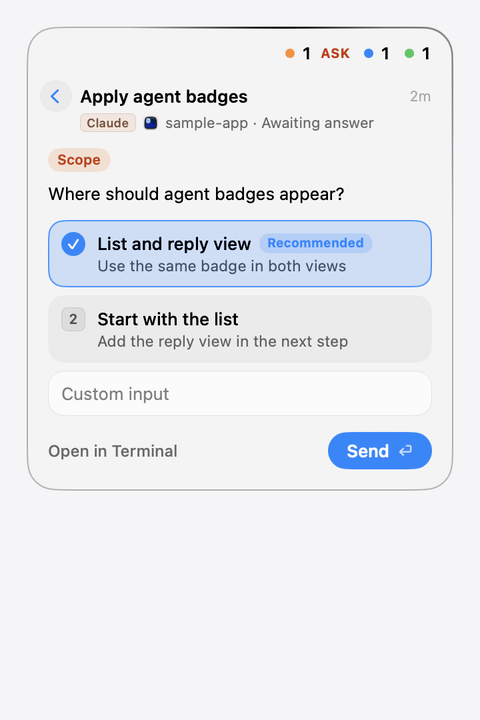</p>

### Keyboard Input

The panel accepts keys only while replying. It does not activate the app; closing returns input to your previous app. Use 1–9 for options, Return to advance/send (only commit composition while an IME is composing), Tab to enter/leave text fields, and Escape to leave a field then return to the list. Fields support Command-C/V/A/Z. Drafts survive reopening the same question, but are discarded when the app exits, the question changes, or the session stops waiting. Review multiple answers together and edit individual questions before sending. Expand long final replies with `Show All`.

### Reply Placement

Choose `Reply View` in the menu:

- **Switch Panel** (default): replace the list with one session's reply.
- **Expand in Row:** expand the clicked row in place.
- **Side Card:** keep the list and open an adjacent reply card.

<p align="center">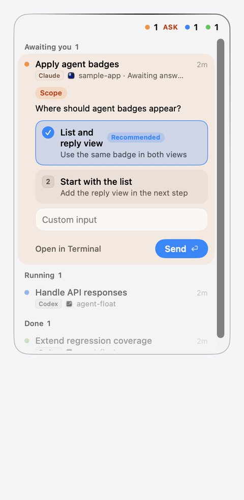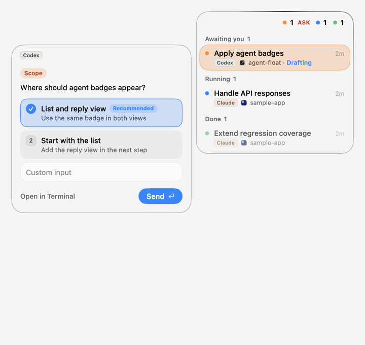</p>

## On Any Background

Glass adapts its tone to the background. When the edge becomes hard to distinguish, choose `Edge Contrast`:

- **Outline** (default): a thin contrasting edge.
- **Inverse of Background:** paint a contrasting pill. Strong on solid colors, less reliable over dense light text.
- **Plain Glass:** preserve the tone chosen by glass.

<p align="center">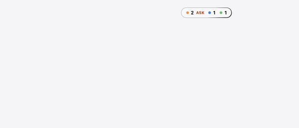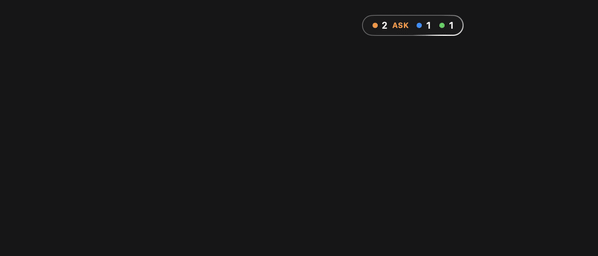</p>

## Installation

Requirements: macOS 26+ (Liquid Glass), Swift 6 (Xcode 26 or Command Line Tools), `/usr/local/bin/orca` for Orca navigation, and a local shared-server Codex CLI for Codex discovery (0.165.0 validated).

```sh
git clone https://github.com/Enjoywater/agent-float.git
cd agent-float
scripts/create-signing-identity.sh   # Once; see Signing below.
make install                       # Assemble, quit the existing app, install, and launch.
```

Use `make install INSTALL_DIR=~/Applications` for another destination.

### First-Run Permissions

The first navigation to Ghostty, Terminal.app, or iTerm2 requests Automation permission for that app. Restore denied permission in System Settings → Privacy & Security → Automation. Replying in Ghostty also requires Accessibility permission to verify its screen. Opening the first Ghostty reply requests it; `Open Settings` provides recovery after denial.

### Signing

The local-only self-signed `Agent Float Local Signing` certificate preserves Accessibility/Automation grants between builds. Create it once with `scripts/create-signing-identity.sh`; it contains only the app name. Without it, builds warn and use ad-hoc signing, which may require renewed permission after every rebuild.

## Menu

By default the app appears only in the menu bar. Settings include `Reset Position`, `Edge Contrast`, `Reply View`, `Icon Location`, `Language`, `Launch at Login`, and `Quit Agent Float`.

- `Icon Location`: Menu Bar (default), Dock, or Both. Dock presence includes Command-Tab; hiding the menu bar icon preserves settings in the Dock context menu.
- `Language` always uses that English title and lists `한국어`, then `English`. Changes apply immediately. Until you choose, the first macOS preferred language selects Korean if it starts with `ko`; all other languages use English. A manual choice persists. There is no Follow System option.
- `Reply View` and `Edge Contrast` are described above.
- `Launch at Login` remembers the registered app location. Register the installed app so `make clean` does not remove it. System Settings may require approval; Option-select can unregister a blocked item.
- Drag the summary row to move the pill. Position persists across launches and is clamped after display changes. `Reset Position` restores its default corner. Lists scroll when needed. Reduce Motion follows the macOS preference.

Herdr support targets the desktop app using `herdr-core` and `herdr-app`, rather than the older `herdr` CLI. Its terminal IDs, process ownership, and window placement must agree. Missing or ambiguous targets fail without falling back to Ghostty. Direct replies in Herdr remain read-only.

## Known Limitations

- The pill can slide during Space-switch animations, returning to its position afterward. Window managers such as Magnet may snap it.
- Manual Orca tab/tmux pane changes do not clear `NEW`.
- tmux inside Ghostty selects the pane but cannot identify its Ghostty tab because Ghostty does not expose tab ttys. Failed Terminal.app/iTerm2 tab selection can change the tmux pane but still beep.
- Claude session files are measured behavior, not a public schema. Unknown values remain gray. No automated/manual-session filter exists.
- Codex requires a local shared server and a uniquely matched live TUI/terminal. Separate, remote, or `--no-daemon` servers are excluded; ambiguous/renamed titles may disappear.
- Reply screen recognition depends on measured Claude Code 2.1.309 and Codex 0.165.0 layouts. Changed screens stop delivery before input or leave an acknowledged failure if input started.
- Ghostty text probing can briefly insert/erase one character in an existing draft. Hidden, other-Space, or split tabs remain read-only.
- Approval is always handled in the terminal. Orca suggestions may look like actual draft text and block delivery.
- System-rendered text, such as text-field context menus, follows macOS language rather than the app's Language setting.
- Question detection is heuristic. Ambiguous conditional explanations can produce waiting false positives; neither language support nor completion status guarantees correctness.

## Development

```sh
make test     # Unit tests; no input to real user sessions.
make bundle   # Assemble and sign build/Agent Float.app.
make run      # Assemble and launch.
make install  # Install and launch after quitting the existing app.
make clean
```

`AgentProvider` is the common protocol; `ClaudeCodeProvider` and `CodexCodeProvider` feed `SessionStore`. `ReplyDelivery` is shared, while screen interpretation and transcript verification follow each agent's format. App copy lives in typed per-language `Strings` values. Core returns semantic data; translate at presentation boundaries. Keep both README editions synchronized.

### Validation

`make test` does not type into real sessions. Tests cover discovery, exited-process exclusion, terminal matching, states/questions, reply verification, and transport failure/recovery.

Optional live tests require explicit user authorization. The first is read-only; the second actually focuses a Ghostty tab:

```sh
AGENT_FLOAT_TEST_LIVE_CODEX=1 swift test --filter liveSharedDaemonReadOnlySmoke
AGENT_FLOAT_TEST_LIVE_NAVIGATION=1 swift test --filter liveDetectedGhosttySessionCanBeFocused
```

Earlier validation displayed only one live TUI among three server threads. Reply integration was tested with an isolated Codex home, local fake model responses, and a real TUI inside isolated tmux, verifying choices, notes, text, and multiple questions without model API calls. See the fixture manifest and optional checks in [Codex validation](docs/codex-detection.md#검증과-범위) (Korean).

For question-rule changes, compare identical samples with `scripts/question-eval`. Raw transcripts and changed examples must stay outside the repository; reports contain only counts and fictional examples.

<details><summary>Development Environment Variables</summary>

Pass overrides with `open --env NAME=value "build/Agent Float.app"`.

| Variable | Effect |
|---|---|
| `AGENT_FLOAT_LANGUAGE=ko\|en` | Overrides saved/system language; useful for isolated media captures |
| `AGENT_FLOAT_DEBUG=1` | State/navigation/window logs on stderr; only debug mode installs USR1/USR2 handlers |
| `AGENT_FLOAT_FAKE_SESSIONS=<count>` | Fictional sessions instead of real providers |
| `AGENT_FLOAT_MEDIA_SCENE=mixed\|choice\|multi\|body\|permission\|ask\|running\|new\|unknown` | Fixed fake media scenario |
| `AGENT_FLOAT_MEDIA_AGENT=claude\|codex` | Agent for the media question |
| `AGENT_FLOAT_CLAUDE_HOME=<folder>` | Alternative Claude storage |
| `AGENT_FLOAT_CODEX_HOME=<folder>` | Codex socket home; otherwise `CODEX_HOME`, then `~/.codex` |
| `AGENT_FLOAT_APPEARANCE=light\|dark` | Appearance override |
| `AGENT_FLOAT_CONTRAST=standard\|outline\|inverse` | Contrast override |
| `AGENT_FLOAT_REDUCE_MOTION=1` | Exercise Reduce Motion |
| `AGENT_FLOAT_SLOW_MOTION=<factor>` | Slow animations |
| `AGENT_FLOAT_REPLY_PLACEMENT=panel\|inline\|card` | Placement override |
| `AGENT_FLOAT_FAKE_REPLY=delivered\|hidden\|accessibility\|draft\|stopped\|mismatch` | Simulated delivery results, only in fake mode |

</details>

<details><summary>Project Layout</summary>

```text
Sources/
  AgentFloatCore/        UI-independent logic
    Claude/              Session files, transcripts, and status derivation
    Codex/               Shared server, live TUI discovery, questions/replies
    Provider/            Provider protocol and SessionStore
    Model/ Signals/      Sessions, grouping, and ASK/NEW
    Navigation/          Terminal navigation and fallback
    System/ Window/      Process inspection and pill geometry
  AgentFloat/            NSPanel, SwiftUI, menus, and localization
Tests/
  AgentFloatCoreTests/   Core tests and screen fixtures
  AgentFloatTests/       App/reply/localization tests
docs/
  specs/ plans/ checklists/  Historical design records (Korean)
  media/                    Korean recordings; English under en/
  en/                       English feature guide
```

</details>

The dated [design documents](docs/specs/2026-10-16-agent-float-design.md) and [rulings](docs/plans/2026-10-16-agent-float-rulings.md) remain in Korean as historical records.
