<p align="center">
  
</p>

<h1 align="center">Agent Float</h1>

<p align="center">
  나를 기다리는 에이전트를 놓치지 않게.
  <br><br>
  <a href="#설치">설치</a> ·
  <a href="https://enjoywater.github.io/agent-float/">기능소개서 ↗</a> ·
  <a href="#지원-에이전트와-탐지-범위">지원 범위</a> ·
  <a href="#한눈에-보는-상태">상태</a> ·
  <a href="#플로팅에서-답하기">답하기</a> ·
  <a href="#알려진-한계">한계</a> ·
  <a href="#개발">개발</a>
</p>

<p align="center">
  
  
  
  
</p>

<p align="center">
  <picture>
    <source media="(prefers-color-scheme: dark)" srcset="docs/media/hero-dark.gif">
    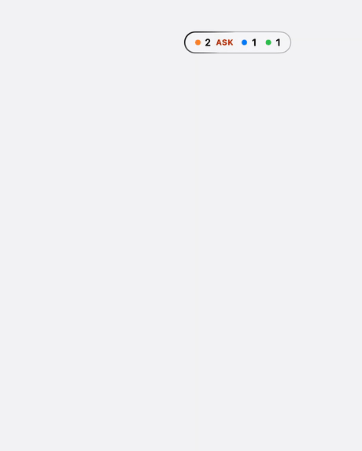
  </picture>
  <br>
  <sub>이 문서의 화면은 모두 데모용 가짜 세션으로 찍었다</sub>
</p>

## 소개

화면과 동작을 함께 보려면 [기능소개서 열기 ↗](https://enjoywater.github.io/agent-float/)를 참고한다. 브라우저에서 바로 열리며 설치 없이 기능 데모를 조작할 수 있다.

여러 터미널에서 AI 에이전트를 동시에 돌리면, 어느 세션이 내 답을 기다리는지 보려고 탭을 하나씩 열어 보게 된다. Agent Float는 탐지한 세션의 상태를 화면 구석의 작은 유리 알약 하나에 모아 보여 주는 macOS 앱이다.

- **본다**: 대기·진행·완료 개수가 알약에 뜨고, 나를 기다리는 세션이 생기면 테두리 빛이 돈다
- **간다**: 마우스를 올리면 세션 목록이 펼쳐지고, 줄을 누르면 그 세션이 열린 터미널 탭으로 이동한다
- **답한다**: 질문하며 기다리는 세션에는 터미널로 가지 않고 그 자리에서 답한다

Claude Code와 Codex 세션을 읽고, 위치를 확인할 수 있는 터미널로 이동하거나 질문에 답할 수 있다. 두 에이전트는 같은 목록과 답장 화면을 사용하지만 탐지 범위에는 차이가 있다.

세션 목록의 두 번째 줄과 답장 헤더에는 `Claude` / `Codex` 이름 배지가 표시된다. 배지는 에이전트 종류를, 옆의 기존 터미널 아이콘은 실행 위치를 뜻한다. 제목 공간과 상태 점의 의미는 유지한다. 패널 전환·줄 안에서 펼침·옆 카드 모두 같은 이름 배지를 사용한다.

## 지원 에이전트와 탐지 범위

| 항목 | Claude Code | Codex |
|---|---|---|
| 탐지 기준 | `~/.claude/sessions`의 세션 파일과 프로세스 생존 확인 | 로컬 공유 app-server 상태와 살아 있는 TUI 프로세스·실제 터미널 대조 |
| 자동화 세션 | 터미널 연결이 없어도 살아 있는 세션 파일이 있으면 포함 | 실제 TUI·터미널이 없는 자동화나 서버 내부 임시 세션은 제외 |
| 이동 | 확인한 터미널 위치로 이동. 위치 종류별 동작은 아래 표 참고 | 제목·작업 폴더로 위치가 하나로 정해진 세션의 터미널로 이동 |
| 답장 | 선택지·직접 쓰기·여러 개 고르기·질문 여러 개·본문 질문 | 선택지 하나 고르기·notes 직접 입력·질문 여러 개·본문 질문 |
| 승인 대기 | 내용만 표시, 승인은 터미널에서 | 내용만 표시, 승인은 터미널에서 |

Codex는 공유 서버에 남은 예전 세션을 열린 세션으로 간주하지 않는다. 같은 Codex 홈과 작업 폴더의 살아 있는 TUI 프로세스, 현재 터미널 제목, 고유한 이동 위치를 함께 확인한다. 닫힌 세션이나 위치가 모호한 항목은 목록에서 제외한다. 변경은 기존 5초 폴링 주기로 반영한다.

Codex 0.165.0에서 검증했다. `--no-daemon`·별도·원격 서버·공유 서버를 사용하지 않는 IDE나 데스크톱 세션은 지원 범위에서 제외한다. 터미널 제목을 임의로 바꾸거나 같은 제목이 중복되면 탐지에서 빠질 수 있다. 자세한 근거와 검증 방법은 [Codex 탐지·이동·답장](docs/codex-detection.md)에 있다.

### 직접 실행하지 않은 세션이 보이는 이유

Claude Code는 봇·스케줄러 같은 자동화 도구가 실행한 세션도 탐지한다. 사용자가 직접 터미널을 열지 않았더라도 프로세스가 살아 있고 세션 파일이 있으면 목록에 나타날 수 있다. 종료된 프로세스의 기록은 제외한다.

Claude 세션 제목은 대화의 AI 제목, 세션 파일의 이름, `이름 없는 세션` 순으로 고른다. AI 제목이 없는 자동화 작업은 `1700000000000-…-draft` 같은 임시 작업 이름이 그대로 보일 수 있다. 숫자 이름만으로 자동화 여부를 판단하지는 않는다.

현재 **직접 실행 / 자동화 / 판별 불가를 자동 분류하거나 필터링하는 기능은 구현하지 않았다.** 터미널 연결 여부, 부모 프로세스, 실행 옵션, 작업 경로를 함께 보면 구분에 도움이 되지만, 터미널이 없다는 이유만으로 자동화라고 확정할 수는 없다. 직접 백그라운드로 띄운 세션도 있기 때문이다.

## 한눈에 보는 상태

접힌 알약에는 상태별 개수가 **대기 → 진행 → 완료** 순으로 나온다.

<table>
  <tr>
    <td align="center" width="50%">
      <picture>
        <source media="(prefers-color-scheme: dark)" srcset="docs/media/state-ask-dark.gif">
        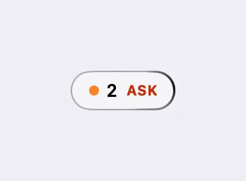
      </picture>
      <br><b>주황 · 내 응답 대기</b>
      <br><sub>권한 승인·질문 도구, 또는 답변이 질문으로 끝난 채 멈춘 세션</sub>
    </td>
    <td align="center" width="50%">
      <picture>
        <source media="(prefers-color-scheme: dark)" srcset="docs/media/state-running-dark.gif">
        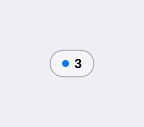
      </picture>
      <br><b>파랑 · 진행 중</b>
      <br><sub>일하는 중이거나, <code>/loop</code>·예약 깨우기·백그라운드 작업처럼 스스로 다시 이어질 세션</sub>
    </td>
  </tr>
  <tr>
    <td align="center">
      <picture>
        <source media="(prefers-color-scheme: dark)" srcset="docs/media/state-new-dark.gif">
        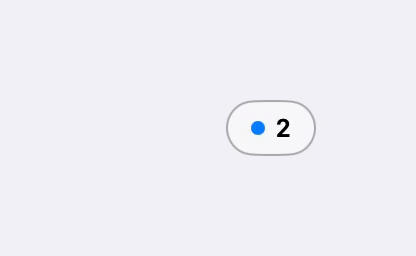
      </picture>
      <br><b>초록 · 완료</b>
      <br><sub>턴이 끝나고 다음 입력을 받을 수 있는 세션. 작업 성공을 보장하지는 않음</sub>
    </td>
    <td align="center">
      <picture>
        <source media="(prefers-color-scheme: dark)" srcset="docs/media/state-unknown-dark.gif">
        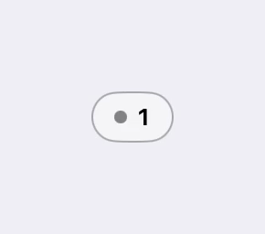
      </picture>
      <br><b>회색 · 상태 확인 불가</b>
      <br><sub>모르는 상태 값이거나 오래 응답이 없는 세션</sub>
    </td>
  </tr>
</table>

봐야 할 것이 있으면 알약 테두리 빛이 돈다.

- `ASK`: 나를 기다리는 세션이 있음. 대기가 실제로 풀려야 꺼짐
- `NEW`: 아직 확인하지 않은 완료가 있음. 플로팅에서 그 줄을 누르거나, Ghostty·Terminal.app·iTerm2에서 그 탭을 직접 고르거나, 세션이 다시 일을 시작하면 꺼짐. 펼치기만 해서는 꺼지지 않음

## 줄을 누르면 그 터미널로

확인한 위치가 있는 줄에는 hover 강조와 클릭 이동이 연결된다. Codex도 같은 이동 기능을 사용한다. 아래의 `claude --bg`와 그 밖의 터미널 폴백은 Claude Code에 해당한다.

| 터미널 | 줄을 누르면 |
|---|---|
| Ghostty | 그 탭으로 이동 (탭 제목과 작업 폴더로 찾음) |
| Orca | 그 터미널 탭으로 이동 (`orca` CLI 사용) |
| Terminal.app · iTerm2 | 그 탭으로 이동 (세션의 tty로 찾음) |
| tmux (어느 터미널 안이든) | 그 pane으로 전환한 뒤 바깥 터미널을 앞으로. Terminal.app·iTerm2면 그 탭까지. 붙은 클라이언트가 없으면 Ghostty 새 탭에서 붙음 |
| `claude --bg` 백그라운드 세션 | Ghostty 새 탭에서 `claude attach <jobId>` 실행 |
| 그 밖의 터미널 (Cursor, Warp 등) | 그 앱만 앞으로 올림 |
| 위치 정보가 없는 세션 | 이동용 hover·클릭 비활성화 |

이동을 시도했지만 대상 탭이나 앱을 찾지 못하면 경고음이 난다. 이동한 뒤 1초 안에 대상 앱이 실제로 앞에 와야 `NEW`가 꺼진다.

## 플로팅에서 답하기

질문 창(선택지·직접 쓰기·여러 개 고르기·질문 여러 개)이나 답변 끝의 질문으로 기다리는 줄을 누르면 답장 화면이 열린다. 승인 대기는 내용만 보여 준다. ⌘+클릭은 지금처럼 바로 이동한다.

Codex는 `request_user_input`의 선택지와 `None of the above`의 notes 입력, 질문 여러 개에 차례로 답하기, 마지막 본문 질문에 답하기를 지원한다. 질문 창에서 여러 항목을 동시에 고르는 기능은 Claude Code에 해당한다. 아래 터미널별 전송 조건은 두 에이전트에 공통으로 적용한다.

<p align="center">
  <picture>
    <source media="(prefers-color-scheme: dark)" srcset="docs/media/reply-choice-dark.gif">
    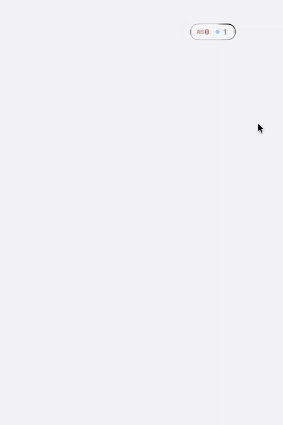
  </picture>
</p>

<table>
  <tr>
    <td align="center" width="33%">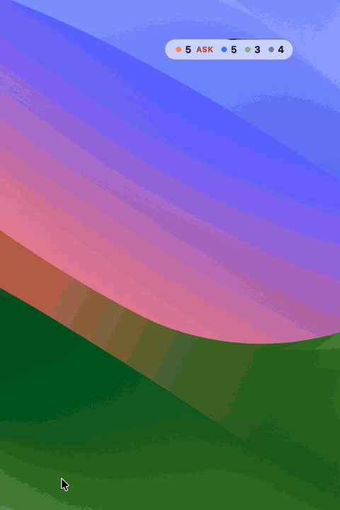<br><b>질문 여러 개</b><br><sub>차례로 고른 뒤 한 번에 확인하고 보냄</sub></td>
    <td align="center" width="33%">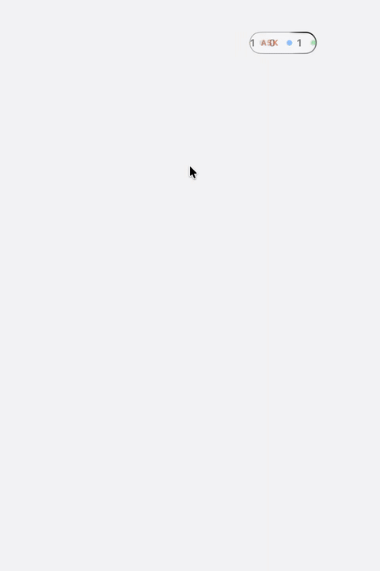<br><b>답변 끝의 질문</b><br><sub>마지막 답변을 보며 직접 써서 보냄</sub></td>
    <td align="center" width="33%">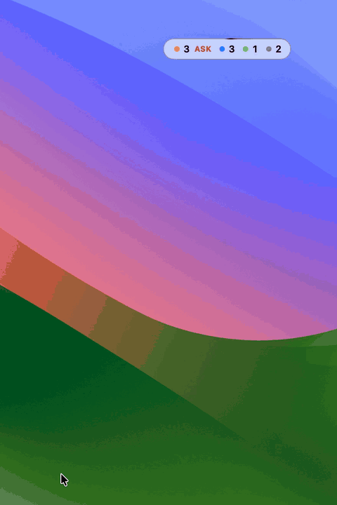<br><b>승인 대기</b><br><sub>내용만 보여 줌. 승인은 터미널에서</sub></td>
  </tr>
</table>

| 터미널 | 질문 창 | 답변 끝의 질문 |
|---|---|---|
| tmux (어느 터미널 안이든, Orca 팀 tmux 포함) | 보냄 | 보냄 |
| Orca | 보냄 | 보냄 |
| Ghostty | 보냄 — 지금 보이는 창의 선택된 탭이고 분할이 없을 때만. 그 밖은 보기만 | 보냄 — 질문 창과 같은 조건 |
| Terminal.app · iTerm2 · 그 밖 | 보기만 | 보기만 |

### 확인할 수 없으면 보내지 않는다

<table>
  <tr>
    <td align="center" width="50%">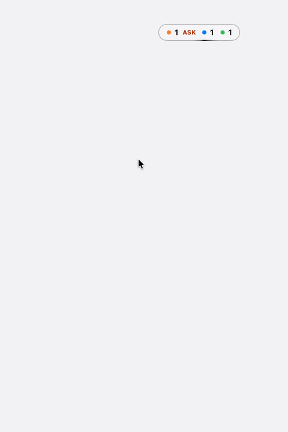<br><b>터미널에 쓰던 글이 있으면 멈춤</b></td>
    <td align="center" width="50%">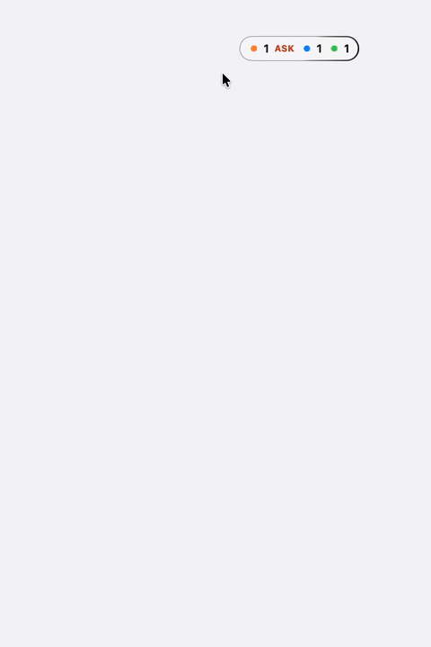<br><b>기록이 다르면 <code>FAIL</code>로 남김</b></td>
  </tr>
</table>

- 보내기는 터미널에 키를 하나씩 넣고 매번 화면이 그 키대로 바뀌었는지 확인한 뒤, 기록된 답이 고른 답과 같은지 대조한다. 확인할 수 없으면 보내지 않고 이유를 보여 준다 (터미널에 쓰던 글이 있음, 질문이 바뀜 등)
- 답변 끝의 질문은 빈 입력 칸에도 흐린 안내 문구가 떠서, 입력 칸에 쓰던 글이 있는지 먼저 가린다: tmux는 글자 스타일(흐림)로, Orca는 입력 칸 글을 따로 알려 주는 `draft`로 넣기 전에 가린다. Ghostty는 둘 다 알려 주지 않아 첫 글자 하나를 넣어 보고, 입력 칸이 그 글자뿐일 때만 나머지를 넣는다. 쓰던 글이 있었으면 그 글자를 지우고 보내지 않는다
- 답장 길이는 두 에이전트 모두 800자(UTF-16 단위)로 제한한다. 이 제한은 Claude Code가 긴 붙여넣기를 `[Pasted text]`로 접는 동작을 기준으로 두었다
- `/`·`!`·`#`로 시작하거나 `@`가 든 답, 여러 줄 답은 자동 완성·줄바꿈이 Enter를 가로챌 수 있어 터미널에서 직접 보낸다
- 보내다 멈추거나 기록이 다르면 알약 맨 앞에 빨간 `FAIL`, 목록 맨 위에 "확인 필요"가 남는다. 그 줄의 실패 화면에서 `닫기`·`터미널에서 열기`를 누르거나 ⌘+클릭해야 꺼진다

### 키 입력

- 답장 화면이 열린 동안만 패널이 키 입력을 받는다. 앱은 앞으로 오지 않고, 닫으면 원래 앱에서 바로 이어서 타이핑할 수 있다
- 1~9 선택지 고르기, ⏎ 보내기(한글 조합 중에는 확정만), Tab 입력 칸 들어가기·나오기, esc 입력 칸에서 나가기 → 목록으로, 입력 칸에서 ⌘C·⌘V·⌘A·⌘Z. 쓰던 답은 다시 열 때까지 남는다

### 답장 화면 배치

메뉴 `답장 화면`에서 고른다.

<table>
  <tr>
    <td align="center" width="50%"><br><b>패널 전환</b> (기본값)<br><sub>패널이 그 세션의 답장 화면으로 바뀜</sub></td>
    <td align="center" width="50%">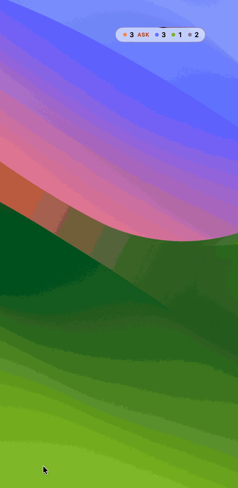<br><b>줄 안에서 펼침</b><br><sub>누른 줄이 그 자리에서 길어짐</sub></td>
  </tr>
  <tr>
    <td align="center" colspan="2">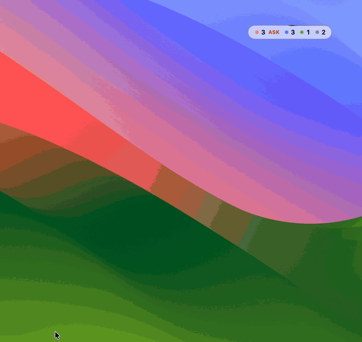<br><b>옆에 카드</b><br><sub>목록은 두고 패널 옆에 카드가 뜸</sub></td>
  </tr>
</table>

## 어떤 배경에서도

알약 유리는 뒤 화면에 맞춰 밝아지거나 어두워진다.

<table>
  <tr>
    <td align="center">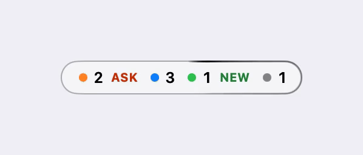<br><sub>밝은 단색</sub></td>
    <td align="center">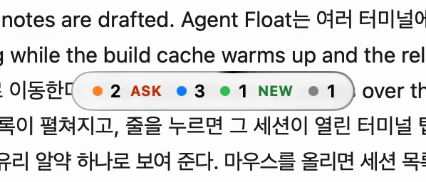<br><sub>글자가 많은 흰 화면</sub></td>
    <td align="center">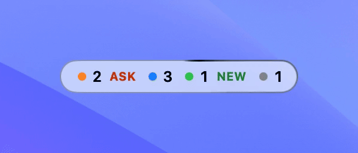<br><sub>배경화면</sub></td>
  </tr>
  <tr>
    <td align="center">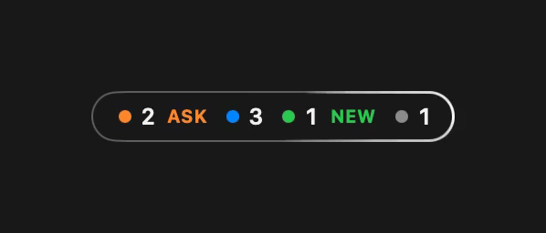<br><sub>어두운 단색</sub></td>
    <td align="center">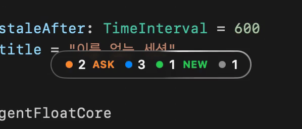<br><sub>코드 편집기</sub></td>
    <td align="center">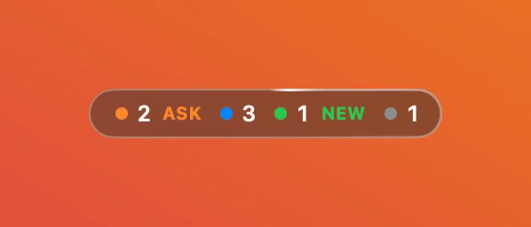<br><sub>원색 그라데이션</sub></td>
  </tr>
</table>

<p align="center"><sub>윗줄은 라이트 모드, 아랫줄은 다크 모드. 모두 기본값 <code>윤곽선</code></sub></p>

같은 톤의 배경에서는 윤곽이 흐려질 수 있어 메뉴 `가장자리 대비`로 고른다.

- `윤곽선` (기본값): 가장자리에 반대 톤의 얇은 선을 두른다
- `뒤 화면과 반대`: 알약을 뒤와 반대 톤으로 칠한다. 단색 배경에서 가장 눈에 띄지만 글자가 많은 흰 화면에서는 대비가 약하다
- `유리 그대로`: 유리가 고른 대로 둔다

## 설치

요구 사항

- macOS 26 이상 (Liquid Glass)
- Swift 6 도구 모음 (Xcode 26 또는 Command Line Tools)
- Orca 이동을 쓰려면 `/usr/local/bin/orca` CLI
- Codex 탐지를 쓰려면 로컬 공유 app-server를 사용하는 Codex CLI (0.165.0 검증)

```sh
git clone https://github.com/Enjoywater/agent-float.git
cd agent-float
scripts/create-signing-identity.sh   # 처음 한 번 (아래 "서명")
make install                         # /Applications 에 설치하고 실행 (켜져 있던 앱은 먼저 종료)
```

다른 폴더에 설치하려면 `make install INSTALL_DIR=~/Applications`.

### 처음 실행할 때 뜨는 권한

- Ghostty·Terminal.app·iTerm2로 처음 이동할 때 그 앱마다 "제어" 승인 창이 한 번 뜬다. 거절했다면 시스템 설정 > 개인정보 보호 및 보안 > 자동화에서 켤 수 있다
- Ghostty 세션에 답하려면 손쉬운 사용 권한이 필요하다(화면을 읽어 확인하기 위해). 처음 Ghostty 세션의 답장 화면을 열 때 승인 창이 뜨고, 거절하면 답장 화면의 `설정 열기`로 켤 수 있다

### 서명

다시 빌드해도 손쉬운 사용·자동화 권한이 유지되도록 로그인 키체인의 로컬 전용 자체 서명 인증서 `Agent Float Local Signing`으로 서명한다. 처음 한 번 `scripts/create-signing-identity.sh`로 만든다(인증서에는 앱 이름만 들어감). 인증서가 없으면 경고를 출력하고 ad-hoc으로 서명하며, 이때는 다시 빌드할 때마다 승인을 다시 물을 수 있다.

## 메뉴

기본은 Dock 아이콘 없이 메뉴바의  아이콘으로 동작한다. 메뉴: `위치 초기화`, `가장자리 대비`, `답장 화면`, `아이콘 위치`, `로그인 시 실행`, `Agent Float 종료`.

- `아이콘 위치`: `메뉴바에서 보기` (기본값) / `Dock에서 보기` / `둘 다 보기`. Dock에 두면 ⌘Tab에도 나온다. 메뉴바 아이콘을 숨겨도 같은 메뉴가 Dock 아이콘의 우클릭 메뉴에 있다
- `답장 화면`: [답장 화면 배치](#답장-화면-배치) 참고
- `가장자리 대비`: [어떤 배경에서도](#어떤-배경에서도) 참고
- `로그인 시 실행`: 등록할 때의 앱 위치를 기억한다. `make install`로 설치한 앱에서 등록하면 `make clean`의 영향을 받지 않는다

## 알려진 한계

<details>
<summary>펼쳐 보기</summary>

- 데스크탑(Space)을 넘기는 애니메이션 동안에는 알약이 같이 밀려 나간다. 전환이 끝나면 같은 자리에 있다
- Magnet 같은 창 관리 앱이 알약을 화면 칸에 붙일 수 있다
- Orca에서 직접 탭을 옮긴 것, tmux 안에서 직접 pane을 옮긴 것은 감지하지 못해 `NEW`가 남는다
- Ghostty 안의 tmux는 tmux pane까지는 가지만 Ghostty 탭은 고르지 못한다 (Ghostty가 탭의 tty를 알려 주지 않음)
- tmux 세션의 바깥 Terminal.app·iTerm2 탭을 고르지 못하면(제어 권한 거절 등) pane만 바뀌고 경고음이 난다
- Claude Code 세션 파일 형식은 공개 규격이 아니라 실측에 기대고 있다. 모르는 상태 값은 회색으로 표시한다
- Codex는 로컬 공유 app-server 상태와 살아 있는 TUI의 고유한 터미널 제목을 대조한다(0.165.0 검증). `--no-daemon`·별도·원격 서버는 제외하며, 제목 변경·중복으로 위치를 확정할 수 없는 세션은 표시하지 않는다
- 답하기는 Claude Code(2.1.309 실측)와 Codex(0.165.0 실측)의 질문 창·입력 칸 모양에 기대고 있다. 모양이 바뀌면 키를 넣기 전이면 보내지 않고, 넣는 도중이면 거기서 멈춰 실패로 표시한다
- Claude 자동화 세션을 직접 실행한 세션과 나누는 표시·필터는 아직 없다. 숫자나 임시 작업 이름으로 표시되는 이유는 [직접 실행하지 않은 세션이 보이는 이유](#직접-실행하지-않은-세션이-보이는-이유) 참고
- Ghostty에서 답변 끝의 질문에 답할 때 입력 칸에 쓰던 글이 있으면, 넣어 본 글자 하나가 잠깐 붙었다 지워진다. 가려진 탭·다른 데스크탑의 창·분할된 탭에는 답할 수 없다(보기만)
- 승인 대기에는 답할 수 없다(내용만 보여 줌)
- Orca에서 흐린 다음 입력 제안이 떠 있으면 쓰던 글로 판단해 답장을 보내지 않는다. 제안과 실제 입력을 구분할 수 없어 터미널에서 직접 답해야 한다

</details>

## 개발

```sh
make test     # 단위 테스트 (swift test)
make bundle   # build/Agent Float.app 조립 + 서명 (위 "서명")
make run      # 조립 후 실행
make install  # 조립 후 /Applications 에 설치하고 실행 (켜져 있던 앱은 먼저 종료)
make clean
```

`AgentProvider`는 에이전트 공통 protocol이다. [ClaudeCodeProvider](Sources/AgentFloatCore/Claude/ClaudeCodeProvider.swift)와 [CodexCodeProvider](Sources/AgentFloatCore/Codex/CodexCodeProvider.swift)가 각각 구현하고, `SessionStore`가 결과를 모은다. 답장 절차는 `ReplyDelivery`를 공유하며 화면 판독과 답장 기록 읽기는 각 에이전트의 형식에 맞춘다.

### 검증

기본 `make test`는 실제 사용자 세션에 입력하지 않는다. Codex 추가와 종료된 세션 제외, 터미널 짝짓기, 상태·질문 판정, 답장 기록 대조, 통신 실패·복구를 회귀 테스트로 확인했다.

기존 공유 서버에 작업 중인 Codex 세션이 있을 때 아래 검사를 별도로 실행할 수 있다. 첫 검사는 상태만 읽고, 두 번째 검사는 실제 Ghostty 탭으로 이동해 포커스를 확인한다.

```sh
AGENT_FLOAT_TEST_LIVE_CODEX=1 swift test --filter liveSharedDaemonReadOnlySmoke
AGENT_FLOAT_TEST_LIVE_NAVIGATION=1 swift test --filter liveDetectedGhosttySessionCanBeFocused
```

실제 사용자 환경에서는 서버에 남은 3개 중 열린 Codex TUI 1개만 표시되는 것과 Ghostty 이동을 확인했다. 답장은 임시 Codex 홈·로컬 가짜 모델 응답 서버·격리된 tmux의 실제 Codex TUI에서 선택지, notes 직접 입력, 본문 답장, 두 질문 연속 답장을 전송하고 기록이 일치하는지 확인했다. 이 전송 검증에는 실제 모델 API를 호출하지 않았다. 재현용 fixture manifest와 선택적 검사 설정은 [Codex 검증과 범위](docs/codex-detection.md#검증과-범위)를 참고한다.

<details>
<summary>개발용 환경 변수</summary>

`open --env 이름=값 "build/Agent Float.app"` 처럼 넘긴다.

| 변수 | 효과 |
|---|---|
| `AGENT_FLOAT_DEBUG=1` | 판정·이동·창 동작 로그를 stderr로 출력 (`open --stderr <파일>`과 같이 쓰면 편함) |
| `AGENT_FLOAT_FAKE_SESSIONS=<개수>` | 실제 세션 대신 가짜 세션으로 화면 확인 |
| `AGENT_FLOAT_CLAUDE_HOME=<폴더>` | `~/.claude` 대신 읽을 폴더 |
| `AGENT_FLOAT_CODEX_HOME=<폴더>` | Codex 공유 서버 소켓을 찾을 폴더. 미설정 시 `CODEX_HOME`, 다음으로 `~/.codex` 사용 |
| `AGENT_FLOAT_APPEARANCE=light\|dark` | 라이트·다크 모양 고정 |
| `AGENT_FLOAT_CONTRAST=standard\|outline\|inverse` | 가장자리 대비를 메뉴 선택보다 우선해 고정 (유리 그대로·윤곽선·반대) |
| `AGENT_FLOAT_REDUCE_MOTION=1` | 동작 줄이기 모드처럼 표시 |
| `AGENT_FLOAT_SLOW_MOTION=<배수>` | 애니메이션을 느리게 |
| `AGENT_FLOAT_REPLY_PLACEMENT=panel\|inline\|card` | 답장 화면 배치를 메뉴 선택보다 우선해 고정 |
| `AGENT_FLOAT_FAKE_REPLY=delivered\|hidden\|accessibility\|draft\|stopped\|mismatch` | 가짜 세션(`AGENT_FLOAT_FAKE_SESSIONS`)일 때 보내기 결과를 흉내 냄. 실제로 보내지 않음 |

</details>

<details>
<summary>폴더 구조</summary>

```
Sources/
  AgentFloatCore/        UI 없는 로직 (단위 테스트 대상)
    Claude/              세션 파일·transcript 읽기와 상태 판정
    Codex/               공유 서버 상태·실제 TUI 탐지, 질문·답장 기록 읽기
    Provider/            에이전트 provider 규약과 여러 provider를 모으는 SessionStore
    Model/ Signals/      세션 모델, 묶음과 ASK·NEW 신호 규칙
    Navigation/          Ghostty·Orca·Terminal.app·iTerm2·tmux 이동과 폴백
    System/ Window/      프로세스 환경·부모·tty 조회, 알약 위치 저장·계산
  AgentFloat/            앱 (NSPanel, SwiftUI 화면, 메뉴바)
Tests/
  AgentFloatCoreTests/   Core 단위 테스트와 화면 fixture
  AgentFloatTests/       답장 화면 상태(ReplyCenter) 테스트
docs/
  specs/                 설계 문서와 화면 시안
  plans/                 구현 계획과 결정 기록(rulings)
  checklists/            사람이 확인할 항목과 결과
  media/                 README 화면 녹화
```

</details>

자세한 판단 근거는 [설계 문서](docs/specs/2026-10-16-agent-float-design.md)와 [결정 기록](docs/plans/2026-10-16-agent-float-rulings.md)에 있다.
